# MATCHA — Drinks Campaign

**Portfolio concept · PANTIK / Pavel Kashyn**

A colourful advertising series for flavoured matcha drinks. Bold typography, contrasting backgrounds and ingredient-led compositions give each flavour its own visual identity.

## Gallery

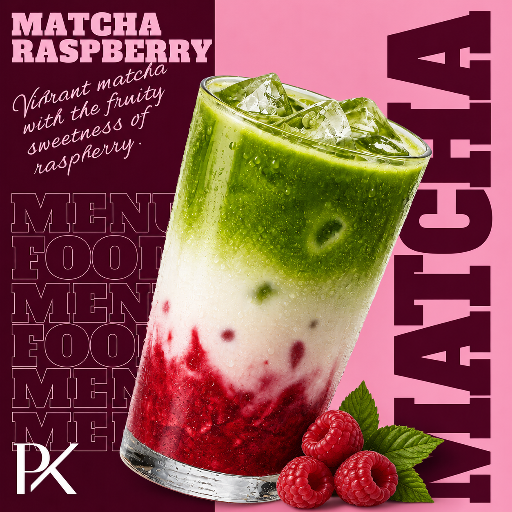

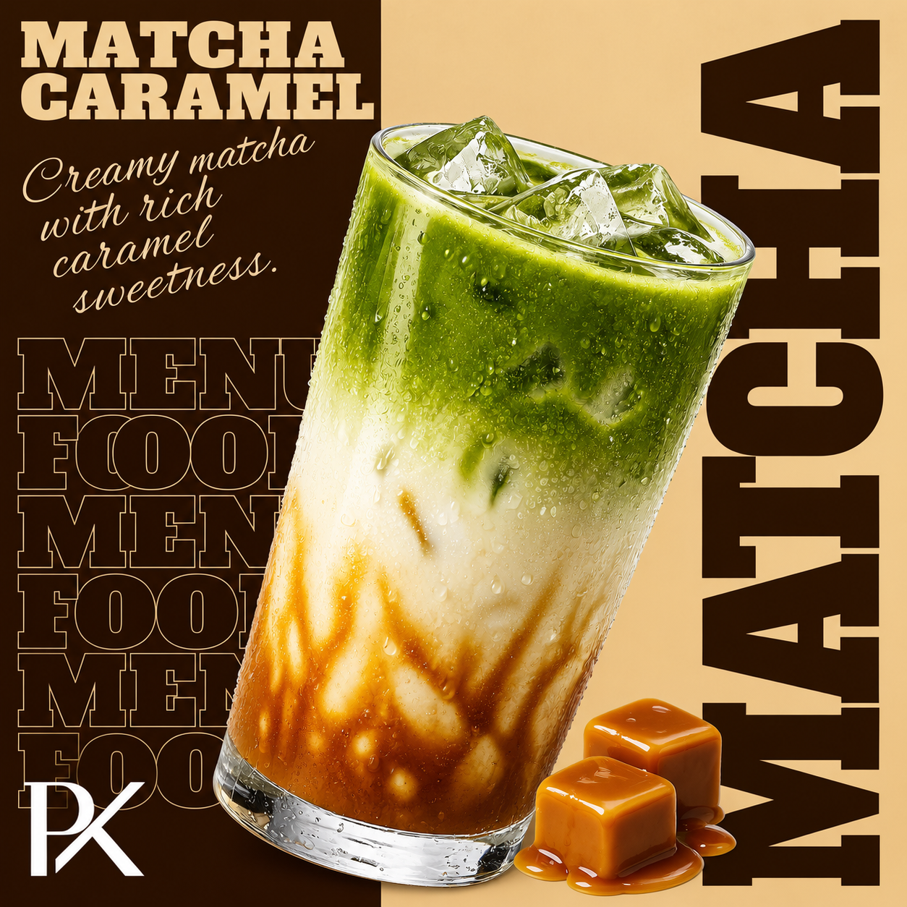

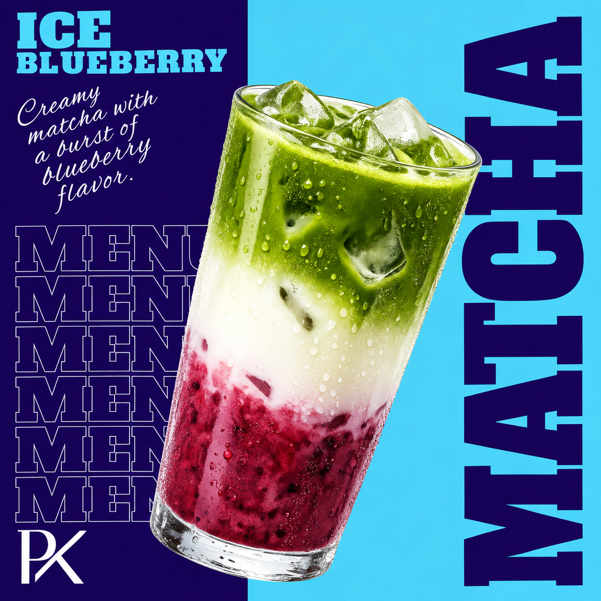

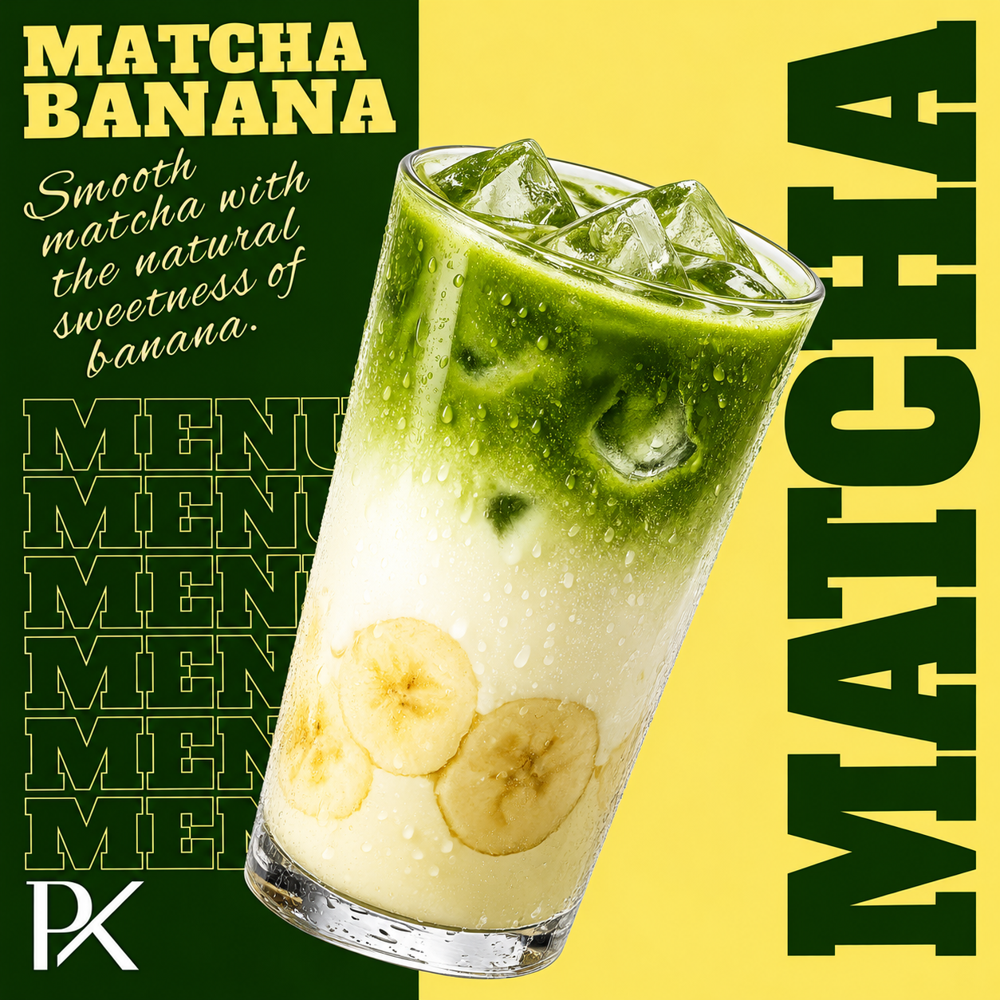

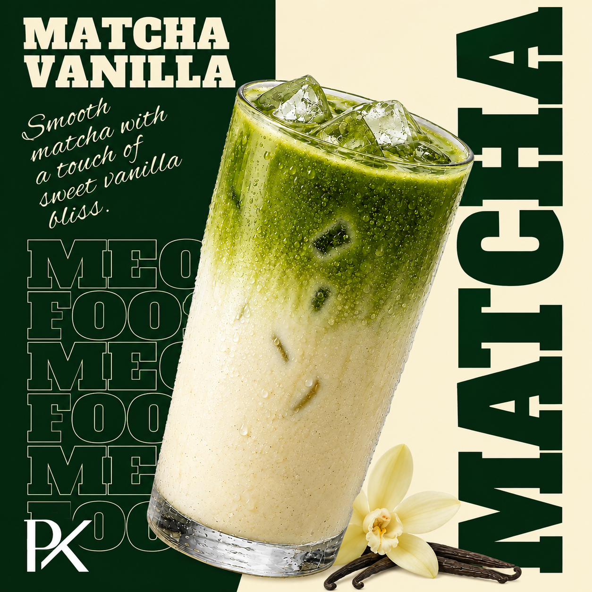

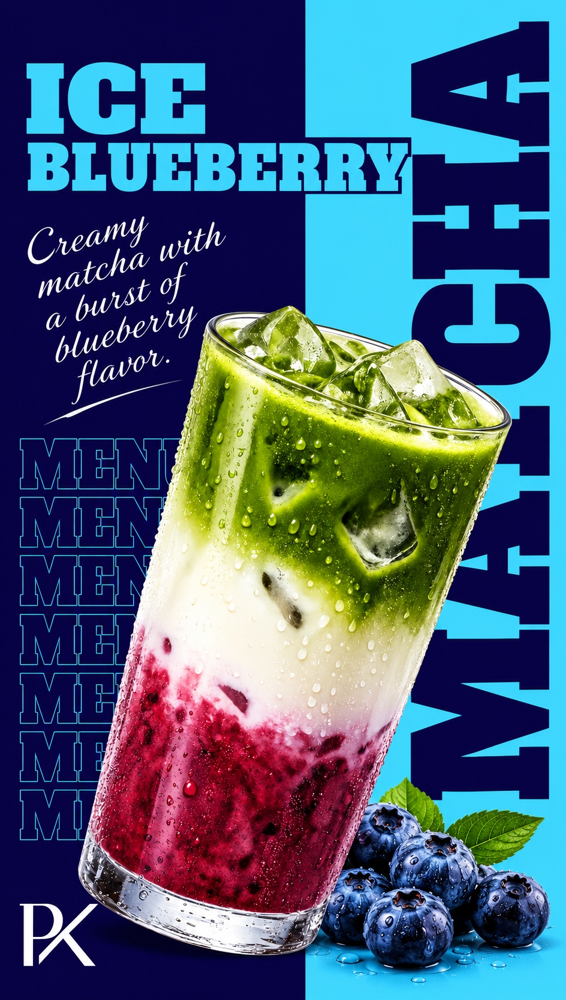

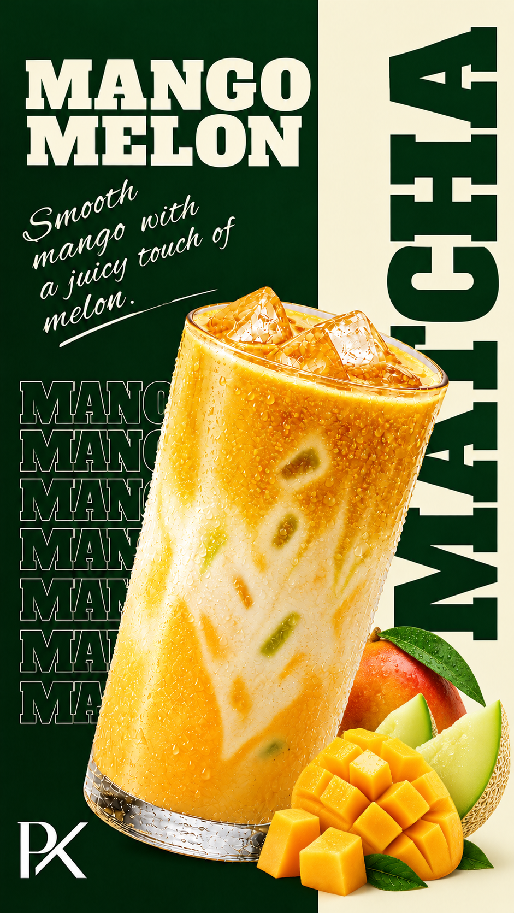

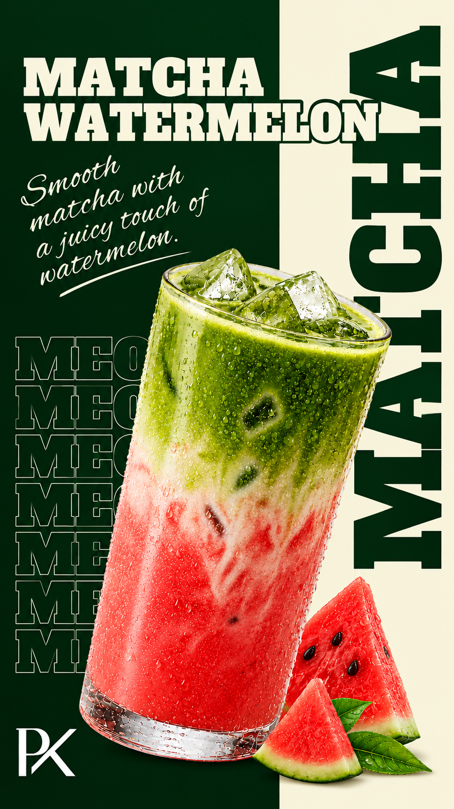

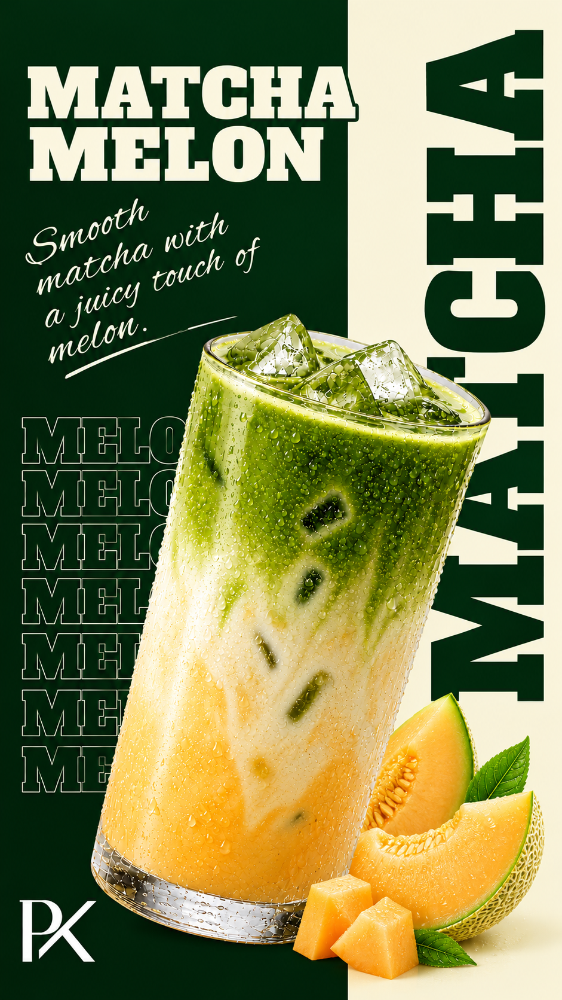

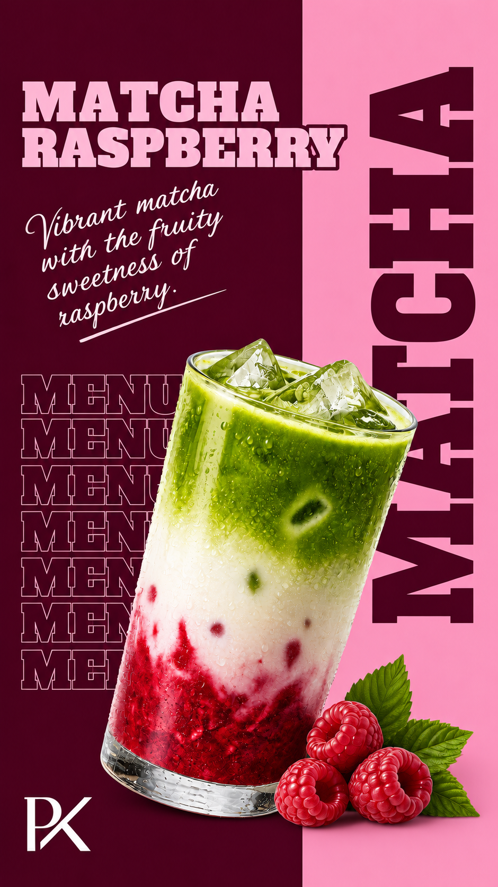

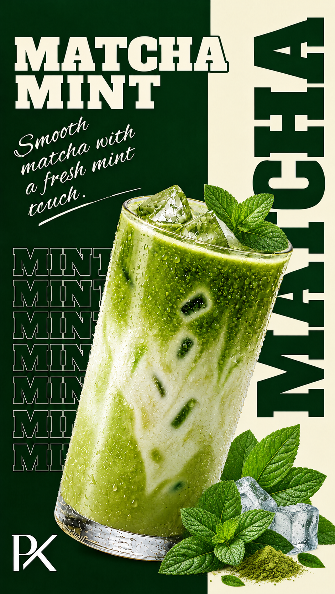

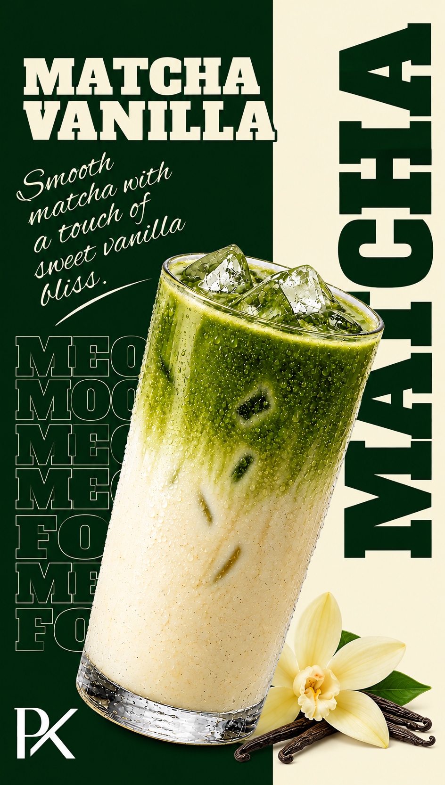

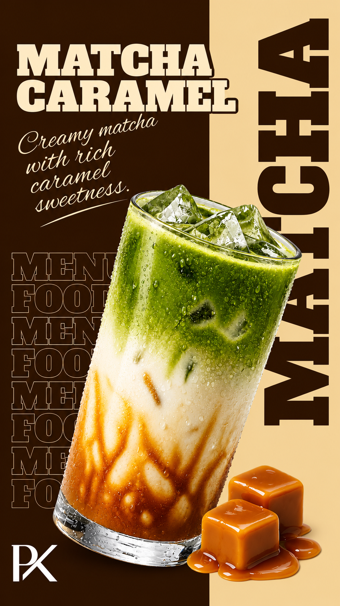

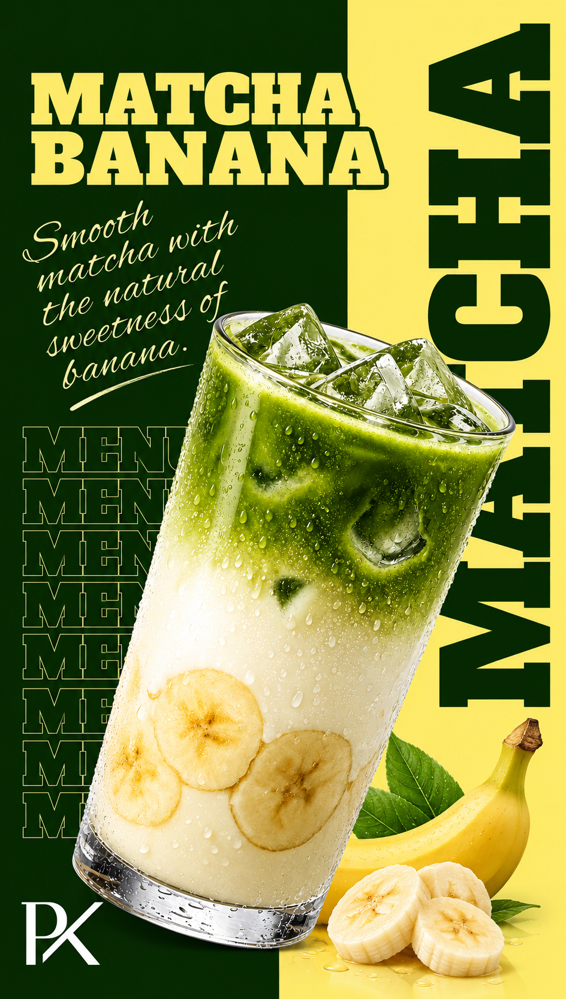

## About

Presented as a design concept for portfolio purposes. Brand names, sample contact details and promotional offers shown in the visuals are part of the concepts.

This repository contains image exports. Editable design source files are not included.

[Portfolio](https://pantikdesign.pages.dev/) · [Behance](https://www.behance.net/paveldesigns) · [Contact](https://t.me/pk_designstudio)
